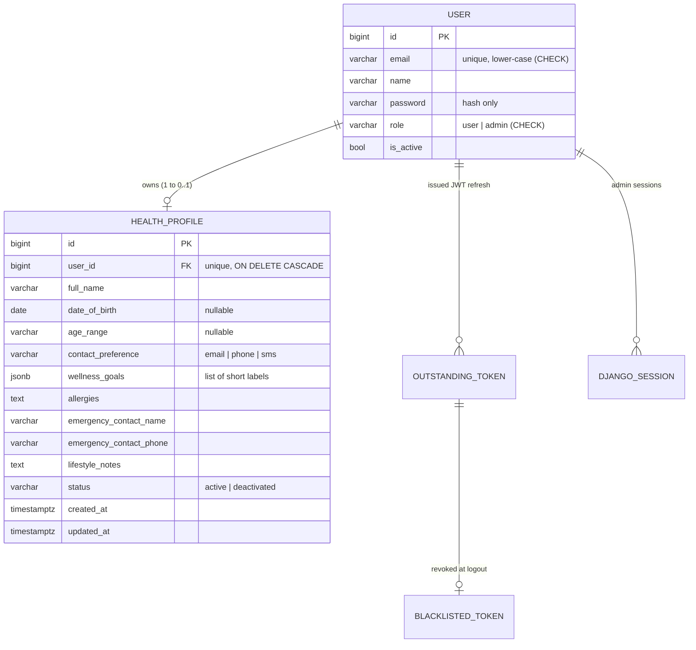

# HealthProfile

A small HealthTech app where people sign up and build a **wellness profile** (goals, contact
preference, emergency contact), and where database-created **admins** search and review those
profiles. Users and admins sign in through **two separate auth systems**.

> **Demo environment.** Every profile is synthetic. No real patient data. Wellness goals only,
> never diagnoses or medical advice.

## Stack

| Layer | Choice | Why |
|---|---|---|
| Backend | Django 6 + Django REST Framework | Sessions, CSRF, password hashing and migrations built in |
| User auth | `simplejwt` + token blacklist | Logout really revokes the refresh token |
| Admin auth | Django server-side sessions | Expires after 30 minutes idle, deleted server-side on logout |
| Database | PostgreSQL | Real `EXPLAIN` plans, DB-level constraints |
| Frontend | Next.js (App Router) + TypeScript | Proxies `/api/*` to Django, so the browser sees one origin |
| API docs | drf-spectacular (Swagger at `/api/docs/`) | Click-through, testable docs |
| Tests | pytest + pytest-django (+ freezegun) | 51 short tests |

## Architecture

```
Browser ──► Next.js :3000 ──(rewrite /api/*)──► Django :8000 ──► PostgreSQL
```

* One origin for the browser, so `SameSite=Lax` cookies work with no CORS setup.
* **Users:** `POST /api/auth/user/login/` sets two **HttpOnly** cookies: `access` (15 min) and
  `refresh` (1 day, only sent to `/api/auth/user/`). The frontend calls `/refresh/` once on a 401
  and retries. Logout blacklists the refresh token. The JWT holds only `user_id`, `exp`, `jti`,
  `token_type`; the role always comes from the database.
* **Admins:** created only with `python manage.py create_admin`. `POST /api/admin/login/` starts a
  session (`sessionid`, HttpOnly, 30 min idle). Every admin view accepts **only** session auth and
  the `IsAdminRole` permission, so a user JWT gets **403** on admin routes.
* **CSRF:** the JWT also lives in a cookie, so every state-changing request (user *and* admin)
  needs the `X-CSRFToken` header. Django rotates the token at login, so the frontend re-fetches
  `/api/csrf/` right after signing in.
* **No IDOR by design:** users only have `/api/profiles/me/`. There is no `/profiles/{id}/` route.
* All errors share one shape: `{"error": {"code", "message", "fields"}}`.

### Database



Constraints: lower-case email, valid role/status/contact preference, and a profile needs a date of
birth **or** an age range.
`wellness_goals` is a JSON list (instead of free text) so the UI can render goal chips.

**Indexes**

| Index | Query it serves |
|---|---|
| unique `email` (+ lower-case CHECK) | login and signup lookups, blocks `Ali@x.com` vs `ali@x.com` |
| unique `user_id` (from OneToOne) | `GET /profiles/me/` |
| `(status, created_at DESC)` | admin list: `WHERE status='active' ORDER BY created_at DESC` |

The optional trigram index on `full_name` was left out (it needs the `pg_trgm` extension).

**EXPLAIN demo**

```bash
python manage.py seed_profiles --bulk 1000
python manage.py shell -c "from profiles.models import HealthProfile as H; print(H.objects.filter(status='active').order_by('-created_at').explain(analyze=True))"
```

With only 5 rows Postgres may prefer a sequential scan because it is cheaper; with ~1,000 rows the
plan uses `profile_status_created_idx`.

## Features

* Sign up (name, email, password strength meter), sign in, sign out
* Create / edit my profile, profile-strength meter, wellness goal chips, add custom goals
* Owner cannot edit a profile once an admin deactivated it (403)
* Admin portal: search by name or email, filter by status, pagination, detail panel,
  full profile page, deactivate with confirmation
* **Light and dark themes**, following the system setting with a manual toggle
* Responsive: single column on mobile

## Run it locally

Prerequisites: Python 3.13, PostgreSQL, Node 20+.

```bash
# 1) Backend  (terminal 1)
cd backend
python -m venv venv
.\venv\Scripts\Activate.ps1          # Windows PowerShell
pip install -r requirements.txt
cp .env.example .env                  # then edit DATABASE_URL, SECRET_KEY, JWT_SIGNING_KEY
python manage.py migrate
python manage.py seed_profiles        # 5 demo members, password: CalmMorning2026
python manage.py create_admin --email admin@healthprofile.test --name "Clinic Admin"
python manage.py runserver            # http://127.0.0.1:8000  (Swagger: /api/docs/)

# 2) Frontend (terminal 2)
cd frontend
npm install
npm run dev                           # http://localhost:3000
```

Pages: `/signup`, `/login`, `/profile`, `/admin/login`, `/admin`, `/admin/profiles/[id]`.

Set `BACKEND_URL` for the frontend if Django is not on `http://127.0.0.1:8000`.

### Tests

```bash
cd backend
python -m pytest
```

Covers signup, user JWT (expired, tampered, blacklisted, throttled), profiles (own-data only,
partial update, validation, 409), and admin (403 for user JWTs, session list/search/detail, CSRF on
deactivate, logout destroys the session row).

## API examples

Full interactive docs: **http://127.0.0.1:8000/api/docs/**

| Method | Path | Auth | Purpose |
|---|---|---|---|
| GET | `/api/csrf/` | none | Sets the `csrftoken` cookie |
| POST | `/api/auth/signup/` | none | Register → 201 / 400 / 409 |
| POST | `/api/auth/user/login/` | none | Sets `access` + `refresh` cookies |
| POST | `/api/auth/user/refresh/` | refresh cookie + CSRF | Rotates tokens |
| POST | `/api/auth/user/logout/` | cookie + CSRF | Blacklists refresh, clears cookies |
| GET | `/api/auth/me/` | JWT | Current user |
| POST / GET / PATCH | `/api/profiles/me/` | JWT (+ CSRF on writes) | Create / read / update my profile |
| POST | `/api/admin/login/` | CSRF | Starts an admin session (403 for non-admins) |
| POST | `/api/admin/logout/` | session + CSRF | Ends the session on the server |
| GET | `/api/admin/me/` | session | Current admin |
| GET | `/api/admin/profiles/?search=&status=&page=` | session + admin | List / search |
| GET | `/api/admin/profiles/{id}/` | session + admin | One profile |
| POST | `/api/admin/profiles/{id}/deactivate/` | session + admin + CSRF | Deactivate |

```http
POST /api/auth/user/login/
{ "email": "momina.asif@example.com", "password": "CalmMorning2026" }

200 OK   (Set-Cookie: access=…; HttpOnly; SameSite=Lax, refresh=…; HttpOnly; Path=/api/auth/user/)
{ "id": 1, "name": "Momina Asif", "email": "momina.asif@example.com", "role": "user", "date_joined": "…" }
```

```http
PATCH /api/profiles/me/        (X-CSRFToken header required)
{ "allergies": "Peanuts" }

200 OK
{ "full_name": "Momina Asif", "age_range": "25-34", "allergies": "Peanuts",
  "status": "active", "completeness": { "percent": 80, "missing": ["Add your date of birth"] }, … }
```

```http
POST /api/auth/signup/
{ "name": "Sara", "email": "sara@example.com", "password": "short" }

400 Bad Request
{ "error": { "code": "validation_error", "message": "Invalid input.",
             "fields": { "password": ["This password is too short. It must contain at least 10 characters."] } } }
```

Status codes: 400 invalid input, 401 not logged in / token expired, 403 not allowed (including
missing CSRF), 404 not found, 409 duplicate email or profile, 429 login throttled (5 per minute).

## Limitations

* Intended for local development: set `DEBUG=False` and HTTPS for production (cookies then become `Secure`).
* No password reset, email verification or profile reactivation yet.
* The "Renews in N min" label is an estimate from when the page last saw a login or refresh, because the
  token cookies are HttpOnly and cannot be read by JavaScript.
